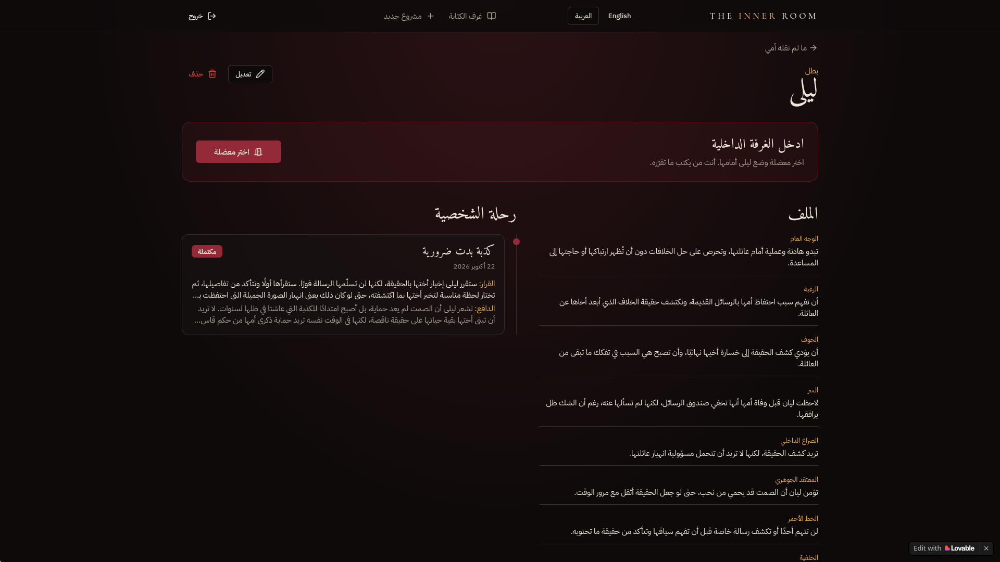
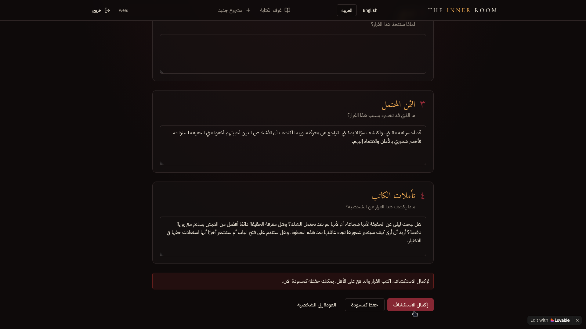
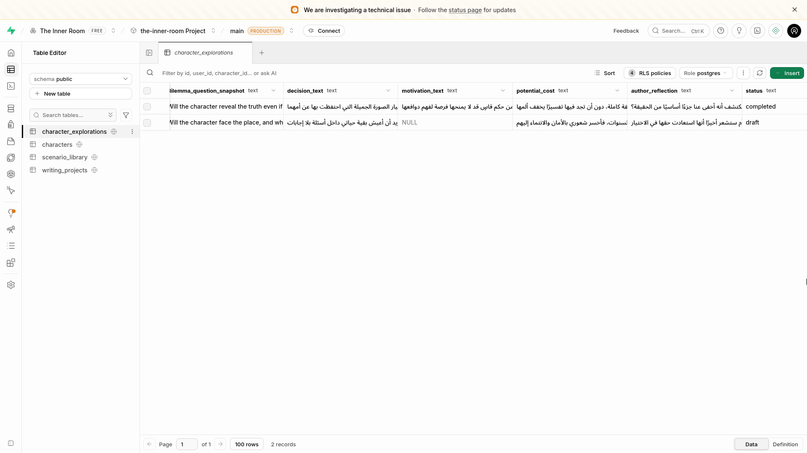
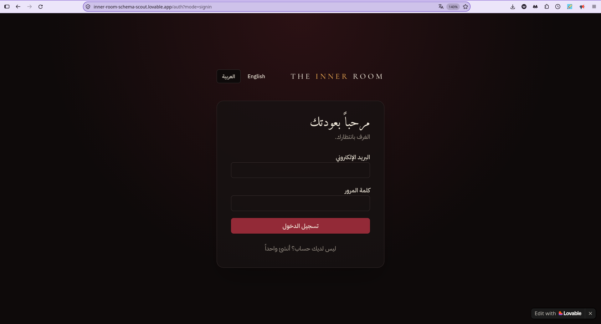
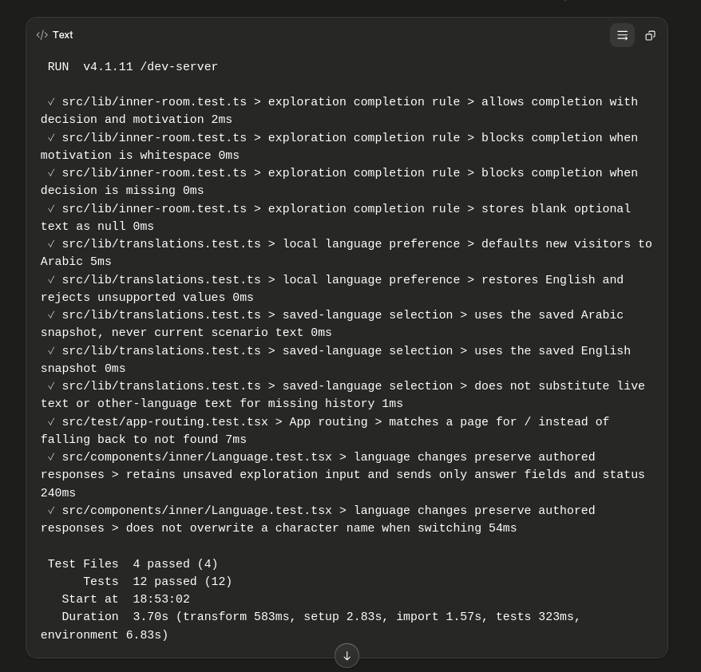
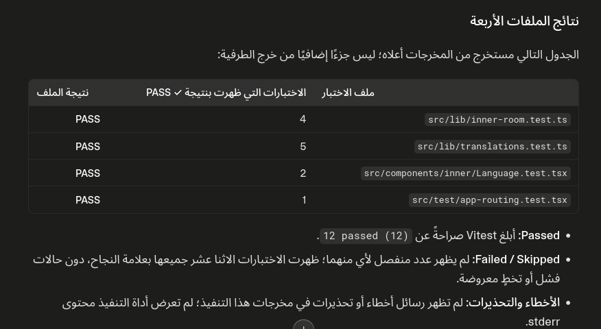

# THE INNER ROOM — مساحة لاكتشاف الشخصيات

**THE INNER ROOM** is a writing-support platform that helps writers explore fictional characters by placing them in difficult dilemmas and recording their decisions, motivations, potential costs, and the author's reflections.

- **Live App:** https://inner-room-schema-scout.lovable.app
- **GitHub Repository:** https://github.com/WeaamR/inner-room-schema-scout
- **Built with:** Lovable and Supabase

## 1. Project Idea

### Problem

Writers can find it difficult to develop believable, consistent characters when a story places them under pressure. Character choices may lack clear motivations, meaningful consequences, or a traceable connection to the character's fears, values, and internal conflicts.

### User

The platform is intended for writers, novelists, screenwriters, and other storytellers who want to develop fictional characters and examine how they respond to challenging situations.

### Solution

THE INNER ROOM provides a structured space where writers create projects and characters, select a dilemma, and document the character's decision, motivation, potential cost, and the author's reflection. Explorations can be saved as drafts or completed when the required decision and motivation are provided.

## 2. Main Features

- User authentication and protected application pages.
- Writing projects with project details and descriptions.
- Character creation and profiles for documenting character traits, fears, secrets, conflicts, and background.
- A scenario library with published dilemmas, categories, and tension levels.
- Character explorations organized around four prompts: Decision, Motivation, Potential Cost, and Author Reflection.
- Draft and completed exploration states, with validation before completion.
- Saved scenario snapshots intended to preserve the scenario wording associated with an exploration.
- Arabic and English interface localization, including language preference persistence and RTL/LTR layout behavior.
- Supabase-backed data storage and database access policies.

## 3. Tech Stack

- **Lovable** — AI-assisted application development.
- **Supabase** — PostgreSQL database and authentication; Row Level Security (RLS) policies are part of the intended access model.
- **React**
- **TypeScript**
- **TanStack Start / TanStack Router**
- **TanStack Query**
- **Vite**
- **Tailwind CSS**
- **Vitest** and React Testing Library for automated tests.

## 4. Testing

### Test 1 — Positive Testing

**Scenario:** Complete a character exploration with a decision and motivation.

**Expected:** The exploration is marked as completed and displays the saved decision and motivation.

**Actual:** The application screen shows a completed exploration with the decision and motivation visible.

**Result:** PASS — based on the supplied application screenshot.

### Test 2 — Negative Testing

**Scenario:** Attempt to complete an exploration while leaving the motivation field empty.

**Expected:** Completion is blocked and a validation message explains that the decision and motivation are required.

**Actual:** The interface displays a validation message asking for the decision and motivation and offers saving as a draft.

**Result:** PASS — the validation response is visible in the supplied screenshot.

### Test 3 — Edge Case

**Scenario:** Save an incomplete exploration as a draft with no motivation value.

**Expected:** The draft is stored with draft status and is not marked as completed.

**Actual:** The Supabase `character_explorations` table screenshot shows a draft record with `status = draft` and `motivation_text = NULL`; a separate completed record is also visible.

**Result:** PASS — the displayed database state supports this draft edge case. This screenshot does not by itself verify every database constraint or trigger.

### Test 4 — Data / Access Testing

**Scenario:** Open a protected application route while logged out.

**Expected:** The unauthenticated user is redirected to the sign-in page rather than seeing protected content.

**Actual:** The supplied screenshot shows the sign-in page at the application's authentication route, with no protected content visible.

**Result:** PASS for the observed sign-in redirect. Cross-user RLS isolation has not been verified by the available screenshots and must not be inferred from this test.

## 5. Bugs Found

Development notes mention issues encountered during implementation, including a missing Supabase JavaScript dependency and localization-related issues. However, the original failing output and a dedicated before/after retest are not available for each issue in the current evidence package. These items are therefore recorded as reported development issues, not as independently verified defect reports.

## 6. Fixes

Development notes report corrective work including adding the Supabase JavaScript dependency and making localization-related adjustments. The current evidence does not establish a complete, independently verifiable **FAIL → FIX → RETEST PASS** sequence for a specific bug. No individual bug fix is claimed as fully verified here.

## 7. Testing Evidence

The screenshots below are included in `docs/testing/`. Screenshots that exposed an account email in the application navigation have had that email obscured before inclusion in this public-sharing package.

### Evidence 01 — Successful Test

Shows a completed character exploration with the decision and motivation displayed.

### Evidence 02 — Validation / Error

Shows the validation message when the required motivation is missing and completion is attempted.

### Evidence 03 — Database Result

Shows the `character_explorations` table with a completed record and a draft record whose motivation is `NULL`.

### Evidence 04 — Authentication / Access

Shows the sign-in screen after the logged-out access flow. This is visual evidence of the displayed authentication page, not proof of RLS isolation.

### Evidence 05a — Automated Test Execution Output

The displayed Vitest output reports 4 passing test files and 12 passing tests, with a duration of 3.70 seconds and exit code 0. This image captures the output as displayed in the Lovable conversation; it is not an independent terminal screenshot.

### Evidence 05b — Automated Test Summary

A secondary summary of the four test files and their reported passing counts.

### Automated Test Coverage Summary

The reported Vitest run covered these existing test files:

- `src/lib/inner-room.test.ts` — 4 tests.
- `src/lib/translations.test.ts` — 5 tests.
- `src/components/inner/Language.test.tsx` — 2 tests.
- `src/test/app-routing.test.tsx` — 1 test.

**Reported result:** 4 test files passed, 12 tests passed, exit code `0`, duration `3.70s`.

These automated tests cover selected local validation rules, language preference and snapshot selection logic, preservation of some unsaved input during language switching, and root-route matching. They do **not** establish that live Supabase writes, database triggers, live scenario rendering, historical snapshot retrieval from real records, or cross-user RLS isolation work correctly. Those behaviors remain unverified in the available evidence.

## 8. Links

- **Live App:** https://inner-room-schema-scout.lovable.app
- **GitHub:** https://github.com/WeaamR/inner-room-schema-scout
- **Lovable:** https://lovable.dev/
- **Supabase:** https://supabase.com/
